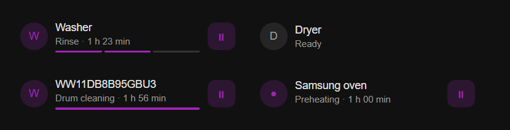
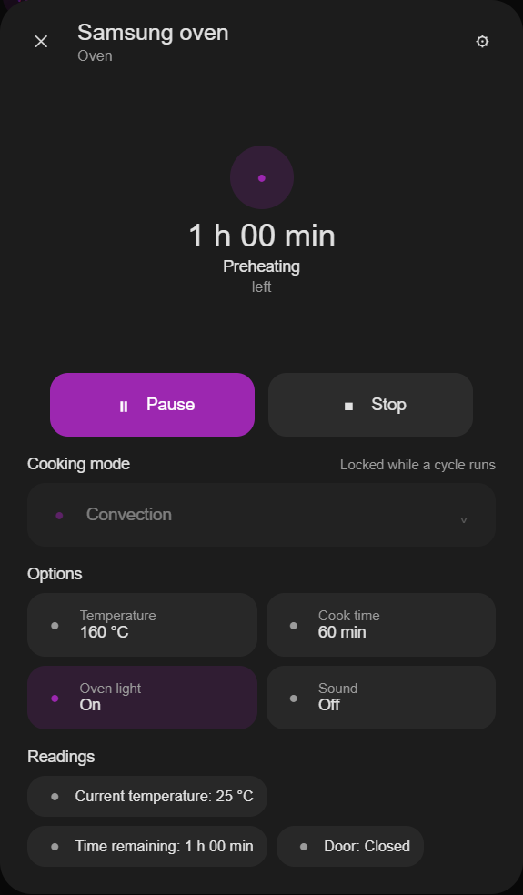

Thank you to [CappyT (Gabriele Turelli)](https://github.com/CappyT) for creating and sharing the original card!

This is my first attempt at forking a card. I only have a washing machine, and I tested it with a Samsung WW11DB8B95GBU3.

# Samsung laundry card

Lovelace card for Samsung washers and dryers exposed by the Home Assistant SmartThings or LocalThings integration, including the `DA_WM_TP1_21_COMMON` washer. The dashboard shows a tile. A tap opens a more-info style dialog with the essential controls:

- remaining time, end time and cycle phases
- start, pause, resume and stop
- cycle selection
- the options of the selected cycle: temperature, spin, rinses, dry level, drying time, delay end, Bubble Soak, wrinkle prevent, Auto Cycle Link, automatic detergent and softener dosing
- detergent and softener levels

This [fork](https://github.com/marsje-core/smartthings-card) adds support for another Samsung washer and firmware variant (`DA_WM_TP1_21_COMMON`), including through LocalThings. I also provide Dutch translations.

The card finds the entities of the device by `translation_key`, so it does not depend on entity IDs. LocalThings cycle actions use its start, pause, and stop buttons; options are limited to entities exposed by the appliance. The accent color is the theme `--primary-color`.

When the washer reports drum cleaning as its current progress, the card displays a single drum-cleaning phase instead of wash, rinse, and spin.

If the same appliance is registered through both integrations, choose the LocalThings device in the card configuration to see its locally exposed options. Selecting the SmartThings device only shows its SmartThings entities.





## Install

### HACS

[](https://my.home-assistant.io/redirect/hacs_repository/?owner=marsje-core&repository=smartthings-card&category=plugin)

1. Open the link above, or search "SmartThings laundry card" in HACS. If HACS does not find it, add `https://github.com/marsje-core/smartthings-card` as a custom repository of type Dashboard.
2. Download the card. HACS adds the dashboard resource.

### Manual

1. Copy `smartthings-laundry-card.js` to `/config/www/smartthings-laundry-card/`.
2. Add a dashboard resource: URL `/local/smartthings-laundry-card/smartthings-laundry-card.js?v=<n>`, type JavaScript module. Increase `v` after each update to bypass the frontend cache.

## Configuration

```yaml
type: custom:smartthings-laundry-card
device_id: <device id of the washer or dryer>
name: Washer # optional
```

`entity: <any entity of the appliance>` can replace `device_id`.

## Releases

Each push to `main` publishes a GitHub release for HACS. Patch versions start at
`v1.2.3` and increase with the first-parent commit count, so version numbers may
skip when multiple commits are pushed together. Avoid rewriting the history of
`main`: release versions depend on that history. The release asset's console
version is set to the release version automatically.

## Development

`dev/harness.html` renders the card with a mocked `hass` object:

```sh
python3 -m http.server 8765 --bind 127.0.0.1
# open http://127.0.0.1:8765/dev/harness.html
```

## License

GNU Lesser General Public License v3.0 or later. See `COPYING.LESSER` and `COPYING`.
