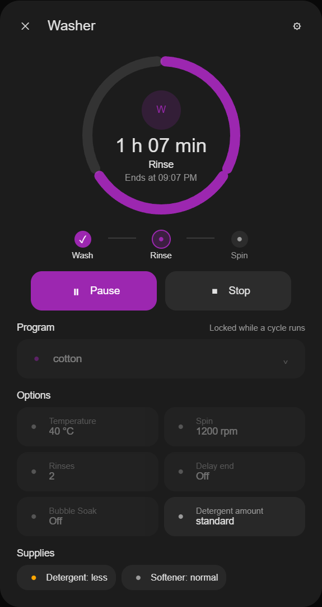
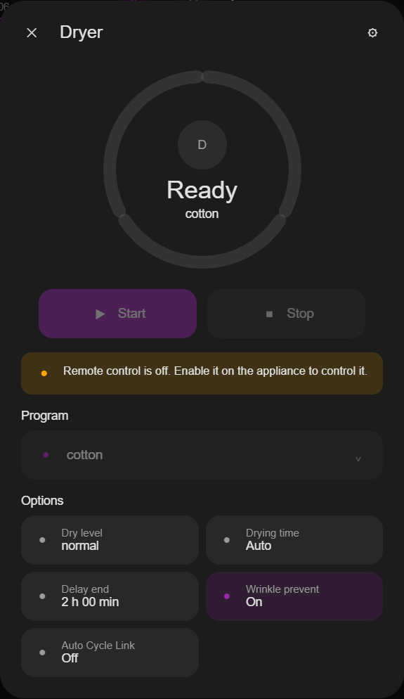

Thank you to [CappyT (Gabriele Turelli)](https://github.com/CappyT) for creating and sharing the original card. Samsung Appliance Card builds on that work with expanded washer, dryer, and oven support.

This is my first attempt at forking a card.

# Samsung appliance card

Lovelace card for Samsung washers, dryers, and ovens exposed by the Home Assistant SmartThings or LocalThings integration, including the `DA_WM_TP1_21_COMMON` washer. The dashboard shows a tile. A tap opens a more-info style dialog with the essential controls:

- remaining time, end time and cycle phases
- start, pause, resume and stop
- cycle selection
- the options of the selected cycle: temperature, spin, rinses, dry level, drying time, delay end, Bubble Soak, wrinkle prevent, Auto Cycle Link, automatic dosing, detergent amount and water hardness, softener amount and concentration
- detergent and softener levels
- oven cooking mode, temperature, cook time, and available oven options

Oven controls appear when exposed by the appliance: mode selection, setpoint and cook-time adjustment, a dedicated Start cooking action, current temperature, remaining time, and door state. Preheating is shown as a distinct status. On the NQ5B4553FBS/U1, modes that cannot be started remotely remain visible but disabled; supported remote-start modes include Convection, Fan Conventional, Large Grill, Fan Grill, Air Fryer, Deodorization, and Keep Warm. The oven light and sound setting can be toggled while cooking; setpoint and cook time also remain adjustable when the integration exposes writable number entities.

This [fork](https://github.com/marsje-core/smartthings-card) adds support for another Samsung washer and firmware variant (`DA_WM_TP1_21_COMMON`), including through LocalThings, and for LocalThings ovens and microwave/oven combinations. It also provides Dutch translations.

The card finds the entities of the device by `translation_key`, so it does not depend on entity IDs. LocalThings cycle actions use its start, pause, and stop buttons; options are limited to entities exposed by the appliance. The accent color is the theme `--primary-color`.

When the washer reports drum cleaning as its current progress, the card displays a single drum-cleaning phase instead of wash, rinse, and spin.

If the same appliance is registered through both integrations, choose the LocalThings device in the card configuration to see its locally exposed options. Selecting the SmartThings device only shows its SmartThings entities.

## Devices and testing

| Appliance | Friendly name | Model or device type | Testing |
|---|---|---|---|
| Washer | Samsung Bespoke AI QuickDrive™ 8000 Series 11 kg washing machine | `WW11DB8B95GBU3` | Tested by me |
| Oven | Samsung NQ7000B 4 Series 50 L compact oven with microwave combi | `NQ5B4553FBS/U1`; SmartThings code `TP1X_DA-KS-OVEN-01061` | Tested by me |
| Washer and dryer | Samsung washer and dryer (original card type) | `DA_WM_TP2_20_COMMON` | Not tested by me; the original card was based on this type |

## Screenshots







## Install

### HACS

[](https://my.home-assistant.io/redirect/hacs_repository/?owner=marsje-core&repository=smartthings-card&category=plugin)

1. Open the link above, or search "Samsung appliance card" in HACS. If HACS does not find it, add `https://github.com/marsje-core/smartthings-card` as a custom repository of type Dashboard.
2. Download the card. HACS adds the dashboard resource.

### Manual

1. Copy `samsung-appliance-card.js` to `/config/www/samsung-appliance-card/`.
2. Add a dashboard resource: URL `/local/samsung-appliance-card/samsung-appliance-card.js?v=<n>`, type JavaScript module. Increase `v` after each update to bypass the frontend cache.

## Configuration

```yaml
type: custom:samsung-appliance-card
device_id: <device id of the washer, dryer, or oven>
name: Washer # optional
```

`entity: <any entity of the appliance>` can replace `device_id`.

## Development

`dev/harness.html` renders the card with a mocked `hass` object:

```sh
python3 -m http.server 8765 --bind 127.0.0.1
# open http://127.0.0.1:8765/dev/harness.html
```

## License

GNU Lesser General Public License v3.0 or later. See `COPYING.LESSER` and `COPYING`.
